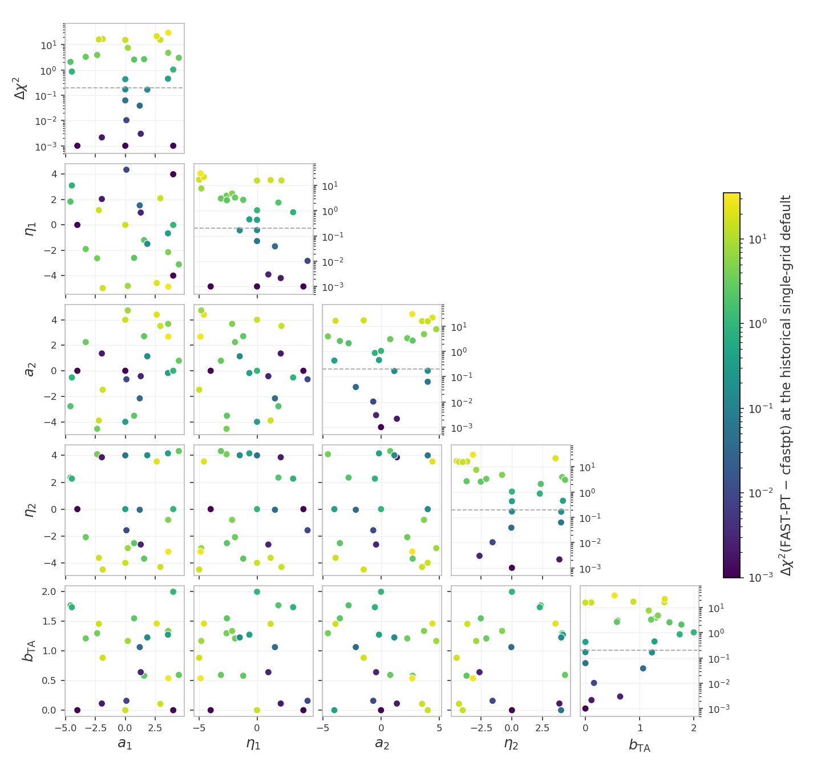
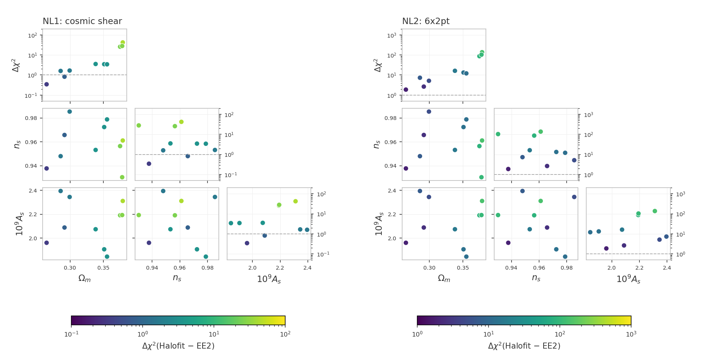
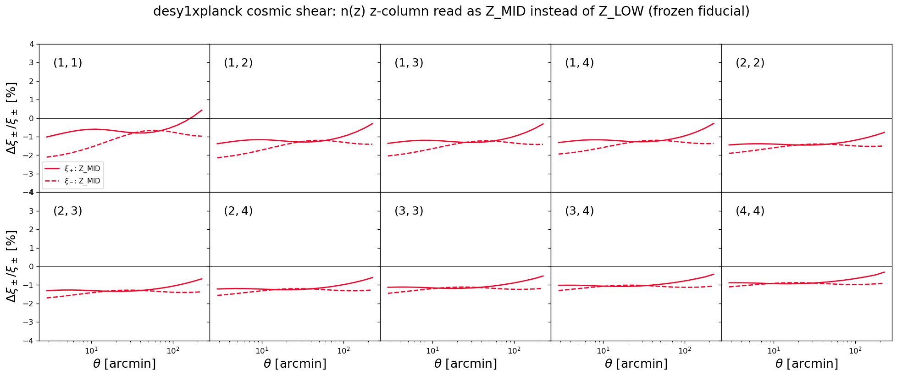
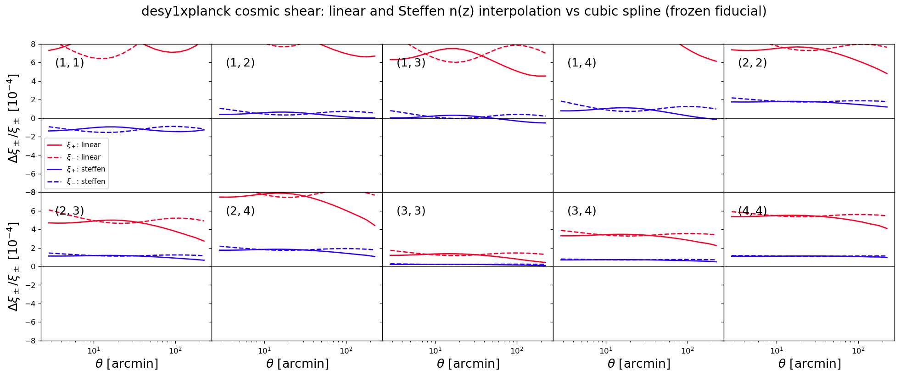

# Unit tests for the likelihoods

The frozen snapshot `frozen/`, its manifest `manifest_sha256.json` and
`generate_frozen_reference.py` live in the parent `tests/` directory;
the paths below are relative to it.

These tests catch two kinds of silent breakage: a $\chi^2$ that drifted
because code or data changed by accident, and a race condition (a bug
where evaluating several points in a row corrupts a later result
through leftover internal state or colliding OpenMP threads).

The mechanism of every shared check family - the frozen-reference and
race contract, the zero-baseline construction, the sweeps and their
`--high`/`--mask` options, the accuracy settings and their meanings -
is documented once in
[the shared data-vector checks](https://github.com/CosmoLike/cocoa-cosmolike-core/blob/main/README.md#dv_checks)
of the CosmoLike core. This file records what desy1xplanck runs and
what it measured.

The reference, race, accuracy, baryonic-feedback and comparison checks
build each model in a worker subprocess of its own; the photo-z,
non-Limber and cache-ladder tests build their models in the pytest
process. Both examples of this project share one data set, so the
worker isolation is preventive: it keeps the tests immune to the
process abort that different data-set dimensions trigger inside
cosmolike, and every project keeps one architecture.

# Table of contents

1. [Running the tests](#run_tests)
2. [The tests](#the_tests)
    1. [The CFASTPT vs FASTPT comparison](#cfastpt_fastpt)
    2. [The Halofit vs EE2 checks](#halofit_ee2)
    3. [The EE2 race test](#ee2_race)
    4. [Accuracy checks](#accuracy_checks)
    5. [Baryonic feedback accuracy checks](#baryon_accuracy_checks)
    6. [Baryonic feedback drift tests](#baryon_drift_tests)
    7. [The photo-z convention checks](#photoz_conventions)
    8. [The non-Limber galaxy-galaxy lensing check](#nonlimber_ggl)
    9. [The non-Limber galaxy clustering check](#nonlimber_gg)
    10. [The sector-ladder cache check](#cache_ladder)
3. [Appendix](#appendix)
    1. [FAQ: What does this project's snapshot hold?](#frozen_copy)
    2. [FAQ: Why does the non-Limber galaxy clustering use separable growth?](#gg_growth_fix)
    3. [FAQ: How can maintainers refresh the snapshot?](#refreeze)

## Running the tests 

We assume users are in the Conda cocoa environment from a previous
`conda activate cocoa` command, that the shell is bash, and that the
current folder is the cocoa main folder `cocoa/Cocoa`. Every command
below assumes `start_cocoa.sh` has been sourced once:

    source start_cocoa.sh

Run the full suite with

    python -m pytest ./projects/desy1xplanck/tests/data_vector

or, without pytest,

    python -m unittest discover -s ./projects/desy1xplanck/tests/data_vector -v

The tests change no project files. Each test prints a progress line
per model build and per evaluation, then a report with the
computed $\chi^2$, the stored reference, the difference, and the pass
limit. A full run performs about 535 likelihood evaluations, half of
them in the three CFASTPT vs FASTPT sweeps. The test files force
`OMP_NUM_THREADS=4` internally.

## The tests 

The standard configurations get four tests each - the frozen-reference
drift check and the race check, in NLA and in TATT
([mechanism and pass limits](https://github.com/CosmoLike/cocoa-cosmolike-core/blob/main/README.md#dv_frozen)).
The TATT variants set

    IA_model: 1
    DES_A2_1: 0.05
    DES_BTA_1: 0.05
    DES_A2_2: -1.51541

The suite follows the shared
[test-file naming convention](https://github.com/CosmoLike/cocoa-cosmolike-core/blob/main/README.md#dv_naming): a file name
means the same thing in every project. This project's
configurations and test numbers:

| file | configuration | tests |
|---|---|---|
| `test_example1.py` | cosmic shear | 1-4: drift and race, in NLA then TATT |
| `test_example2.py` | 6x2pt | 5-8: drift and race, in NLA then TATT |
| `test_example2_2x2pt.py` | 2x2pt (`desy1xplanck.combo_2x2pt`, the 6x2pt configuration reduced to galaxy clustering plus galaxy-galaxy lensing) | 11-14: drift and race, in NLA then TATT |
| `test_fastpt.py` | the sweep on cosmic shear, the 6x2pt likelihood (`desy1xplanck.combo_6x2pt`) and the 2x2pt likelihood (`desy1xplanck.combo_2x2pt`) | 15, 16, 17 |
| `test_ee2.py` | cosmic shear, NLA with EE2 (`non_linear_emul: 1`) | 18: race, including EE2's own threaded compute |

Tests 9 and 10 are not used: the numbering follows the shared
convention, where they are the frozen FAST-PT reference checks
this project does not ship.

### The CFASTPT vs FASTPT comparison (`test_fastpt.py`, tests 15-17) 

The sweep mechanism, the zero-baseline construction and the
`--high`/`--mask` options are in
[the shared checks](https://github.com/CosmoLike/cocoa-cosmolike-core/blob/main/README.md#dv_fastpt).
Here, test 15 runs the sweep on cosmic shear, test 16 on the 6x2pt
likelihood and test 17 on the 2x2pt likelihood. In test 16 the TATT
terms also enter galaxy-galaxy lensing, and the frozen configuration
fixes the one-loop bias amplitudes (`DES_B2_*`) at zero, so the
one-loop galaxy-bias tables both implementations compute multiply by
zero, and the CMB-lensing cross-correlations carry only the linear
(A1) alignment term: the sweep scores the intrinsic-alignment tables
alone, on the wider data vector. In test 17 clustering carries no
intrinsic alignment, so there the TATT tables are scored through
galaxy-galaxy lensing alone, under the 2x2pt masked inverse
covariance.

The desy1xplanck scale-cut masks `--mask` accepts: `frozen` (the
default) keeps the shipped 6x2pt mask of the frozen contract (738 of
the 1,809 data points); `ones` keeps every point (no scale cuts), the
strictest comparison. The 6x2pt sweep aborts under `ones` (see the
warning below).

> [!NOTE]
> With one 1,100-point grid serving both (no upsampling), the
> difference reaches $\Delta\chi^2 = 29.6$ across the prior (first row
> of the table below).

The point values, the design, and the decision record live with the
lsst_y1 project (its tests/data_vector/README.md carries the full discussion);
the table below is this project's own measurement:

| output table (points) | internal grid (points) | max $\Delta\chi^2$ | Runtime / first row |
|---|---|---|---|
| 1,100 | 1,100 (shared) | 29.6 | 1.00 |
| 1,024,900 (`accuracyboost: 1`, the default) | 1,100 (the default) | 0.000239 | 1.27 |
| 2,048,900 (`accuracyboost: 2`) | 1,300 (`internal_accuracyboost: 2`) | 0.000170 | 1.55 |

Runtime ratios use the first row of this table as the baseline, with the
same timed scope and machine. They compare sampling costs within this
project; absolute runtimes depend on the machine.

Measured on 2026-09-23:

- Test 16 (6x2pt): max $\Delta\chi^2 = 0.000245$ at the defaults,
  $0.000134$ at the pushed camb/cosmolike settings,
  indistinguishable from cosmic shear's max $\Delta\chi^2 = 0.000239$
  at the same points under the 6x2pt masked covariance.
- Test 17 (2x2pt): max $\Delta\chi^2 = 0.000008$ and $0.000003$, the
  mildest of the three, with the TATT tables entering through
  galaxy-galaxy lensing alone.
- `--mask=ones` (no scale cuts: every entry of the probe's own blocks
  weighted): cosmic shear measures max $\Delta\chi^2 = 0.004813$ at the
  default camb/cosmolike settings and $0.000224$ at the pushed
  settings; 2x2pt measures max $\Delta\chi^2 = 0.003061$ and
  $0.000249$. Every run stays well inside the $\Delta\chi^2 = 0.2$ band.

> [!Warning]
> The 6x2pt sweep cannot run under `--mask=ones` (2026-09-23): with
> every point unmasked the shipped 6x2pt covariance is not positive
> definite (67 non-positive eigenvalues on the full 1,809-point
> matrix; under the frozen 738-point mask it is positive definite)
> and cosmolike aborts the model build (`IP::set_inv_cov`). Test 16
> therefore fails under this mask; tests 15 and 17 run.

> [!NOTE]
> The fastpt defaults hold this accuracy on their own; raising the
> boosts is a convergence test, not a need. cfastpt (`IA_code: 0`)
> remains the reference implementation.

Run the comparison at the default and at the pushed camb/cosmolike
settings (the full comparison is both invocations):

    python -m pytest ./projects/desy1xplanck/tests/data_vector/test_fastpt.py
    python -m pytest ./projects/desy1xplanck/tests/data_vector/test_fastpt.py --high=1

### The Halofit vs EE2 checks (`test_nonlinear.py`, NL1-NL2) 

[Mechanism](https://github.com/CosmoLike/cocoa-cosmolike-core/blob/main/README.md#dv_halofit_ee2):
NL1 evaluates the cosmic-shear data vector and NL2 the 6x2pt one
(`desy1xplanck.combo_6x2pt`), each with both nonlinear-power sources
at the ten shared cosmologies; Halofit (`non_linear_emul: 2`) is the
frozen contracts' setting. The `--mask` option applies, with the
masks of the CFASTPT section; NL2 cannot run under `ones`: the fully
unmasked 6x2pt covariance is not positive definite and cosmolike
aborts the model build, as the warning in the CFASTPT section
describes for test 16.

Measured on 2026-09-23 (the figure below, frozen mask):

- NL1 (cosmic shear): per-cosmology $\Delta\chi^2$ between 0.3 and
  42.2 (median 3.4) under the frozen mask, and between 0.4 and 71.2
  (median 6.2) under `--mask=ones`.
- NL2 (6x2pt): per-cosmology $\Delta\chi^2$ between 1.9 and 137.2
  (median 12.7) under the frozen mask, its only measurement; the run under `--mask=ones` ends in
  the abort described above (`IP::set_inv_cov: masked cov not
  positive definite`).
- Every sweep peaks at the high-omegam draws; at these ten
  cosmologies the two nonlinear-P(k) sources are not
  interchangeable at this project's precision even under the frozen
  scale cuts.

Run the checks under the frozen scale cuts, then with every data
point kept:

    python -m pytest ./projects/desy1xplanck/tests/data_vector/test_nonlinear.py
    python -m pytest ./projects/desy1xplanck/tests/data_vector/test_nonlinear.py --mask=ones

### The EE2 race test (`test_ee2.py`, test 18) 

[Mechanism and the pinned EE2 modifications](https://github.com/CosmoLike/cocoa-cosmolike-core/blob/main/README.md#dv_ee2):
test 18 is the race check with the nonlinear $P(k)$ from EE2, whose
compute is OpenMP-threaded. The modification gate - the
pre-modification build (the `EE2_GIT_COMMIT` that
`set_installation_options.sh` keeps commented) compiled side by side
and compared against the installed one, data vector by data vector -
runs as lsst_y1's test 18; the modifications do not depend on the
project, so one gate serves every project.

Measured on 2026-09-23:

- Test 18: the fresh and 10th-in-a-row fiducial agree to all eight
  printed decimals.
- The gate's side-by-side comparison, run against this project's
  cosmic shear under its frozen mask (ten cosmologies): max
  $\Delta\chi^2 = 7.2\times10^{-7}$, with a max fractional
  data-vector difference of $1.7\times10^{-5}$.

### Accuracy checks (`test_accuracy.py`, A1-A6) 

[Mechanism, setting meanings and cost order](https://github.com/CosmoLike/cocoa-cosmolike-core/blob/main/README.md#dv_accuracy):
the checks first change one accuracy setting at a time on the 6x2pt
NLA configuration, keeping an `accuracyboost: 5` entry as a stress
value (it would expose a cosmolike table whose size does not follow
the boost); checks A1-A6 then re-evaluate cosmic shear, 6x2pt, and
2x2pt, with NLA and TATT, with every setting pushed at once. This
project's pushed values:

| setting | raised to |
|---------|-----------|
| `accuracyboost` (cosmolike) | 3 |
| `integration_accuracy` (cosmolike) | 10 |
| `internal_accuracyboost` (cosmolike) | 2 |
| `lmax` (cosmolike) | 200000 |
| `kmax_boltzmann` (cosmolike) | 40 |
| `AccuracyBoost` (CAMB) | 2 |
| `k_per_logint` (CAMB) | 50 |
| `kmax` (CAMB) | 50 |

The nested z-grid construction that `accuracyboost` refines is
commented in `likelihood/_cosmolike_prototype_base.py`. The default
`internal_accuracyboost: 1.0` runs the C-FAST-PT convolutions on the
output grid itself, the exact reference path; an lsst_y1 scan
measured $\Delta^T C^{-1} \Delta \le 10^{-9}$ against that path for
internal grids down to 0.27.

#### Why these accuracy defaults? 

The comments next to the `accuracyboost` lines of this project's yaml
files record the convergence of the boost against a synthetic 6x2pt
data vector computed at boost 16. Values above 3 do not break the
integration tables: the cosmolike core compiled here scales the FFTLog
zero-padding with the chi grid
(`external_modules/code/cosmolike/cosmo2D.c`).

Run them on their own, or skip them (high-accuracy evaluations take
minutes):

    python -m pytest ./projects/desy1xplanck/tests/data_vector/test_accuracy.py
    python -m pytest ./projects/desy1xplanck/tests/data_vector --ignore ./projects/desy1xplanck/tests/data_vector/test_accuracy.py

### Baryonic feedback accuracy checks (`test_accuracy_baryons.py`, BF1-BF7) 

[Mechanism](https://github.com/CosmoLike/cocoa-cosmolike-core/blob/main/README.md#dv_baryons):
one advisory check per feedback method (the three SP(k) fb relations,
BCEmu, Flamingo, BACCOemu, and BCemu2025) repeats the
default-versus-high accuracy comparison with the `bfmt` theory block
switched on; the check BF0 additionally runs the
one-setting-at-a-time scan with the Akino SP(k) feedback on, so a
large delta names the setting causing it.

These checks, and the drift tests below, need the `bfmt` theory block
and the emulators of its methods, which Cocoa's setup installs unless
`IGNORE_BFMT_CODE`, `IGNORE_PYSPK_CODE`, `IGNORE_BCEMU_CODE`,
`IGNORE_FBRE_CODE` or `IGNORE_BACCOEMU_CODE` is set in
`set_installation_options.sh` (see the
[baryonic feedback section](../../README.md#desy1xplanck_baryonic_feedback)
of the project README). The section *Baryonic feedback from the `bfmt`
theory block* of [EXAMPLE_EVALUATE1.ipynb](../../EXAMPLE_EVALUATE1.ipynb)
runs six of these methods outside the tests and tabulates their
$\chi^2$ against the measured data.

Every checked configuration is measurable by construction. The
BACCOemu check evaluates with `omegab: 0.049`, inside that
emulator's baryon-density training box, whose floor sits exactly
above the fiducial `omegab: 0.04`; and the double-power-law point is
chosen to keep the baryon fraction inside SP(k)'s calibrated band
over the full redshift grid.

Run them with

    python -m pytest ./projects/desy1xplanck/tests/data_vector/test_accuracy_baryons.py

### Baryonic feedback drift tests (`test_baryons.py`, BD1-BD7) 

[Mechanism](https://github.com/CosmoLike/cocoa-cosmolike-core/blob/main/README.md#dv_baryons):
one drift test per feedback method, against the default-settings
vector stored at freeze time (`generate_frozen_reference.py
--baryons`); a $\chi^2$ above the tolerance means cosmolike or the
`bfmt` theory block changed its prediction since the freeze. Run
them with

    python -m pytest ./projects/desy1xplanck/tests/data_vector/test_baryons.py

### The photo-z convention checks (`test_photoz_conventions.py`) 

[Mechanism](https://github.com/CosmoLike/cocoa-cosmolike-core/blob/main/README.md#dv_photoz):
the frozen cosmic-shear fiducial under the default, each alternative
convention, and the default again. In this project the round trip
back to the default must reproduce the first printed data vector
(9 significant digits) entry for entry. Measured on 2026-09-25:

- default: $\chi^2 = 0.000000$ (the frozen reference exactly).
- linear: $\Delta\chi^2 = 1.3\times10^{-3}$; Steffen:
  $\Delta\chi^2 = 5.7\times10^{-5}$. Either interpolant change is far below
  the survey's statistical precision.
- Z_MID: $\Delta\chi^2 = 0.42$ - the half-bin z-column reading
  is the one photo-z convention that matters at this precision.

The figures below are regenerated by
`generate_photoz_convention_figure.py`:

### The non-Limber galaxy-galaxy lensing check (`test_nonlimber_ggl.py`) 

[Mechanism and assertions](https://github.com/CosmoLike/cocoa-cosmolike-core/blob/main/README.md#dv_nonlimber):
in this project galaxy-galaxy lensing defaults to Limber
(`adopt_limber_gs: 1`), because its lensing kernel is broad; the test
evaluates the frozen 6x2pt fiducial with Limber, non-Limber, and
Limber again, and prints the contribution of each lens-source pair.

Measured on 2026-10-01:

- $\Delta\chi^2 = 0.0039$ for the 6x2pt data vector, far below the
  survey's statistical precision; the largest pair, (3,2), contributes
  $\Delta\chi^2 = 0.0019$.

### The non-Limber galaxy clustering check (`test_nonlimber_gg.py`) 

[Mechanism and assertions](https://github.com/CosmoLike/cocoa-cosmolike-core/blob/main/README.md#dv_nonlimber):
galaxy clustering defaults to non-Limber (`adopt_limber_gg: 0`) in
this project; the test evaluates the frozen 6x2pt fiducial with the
default, the other setting, and the default again, and prints the
contribution of each lens bin.

Measured on 2026-10-01:

- $\Delta\chi^2 = 6.61$ for the 6x2pt data vector, against
  $\Delta\chi^2 = 0.0039$ for the same comparison in galaxy-galaxy
  lensing.
- Lens bins 3, 2, 1, 0 contribute $\Delta\chi^2$ = 4.43, 2.02, 0.18,
  0.07 (each bin's block alone).

### The sector-ladder cache check (`test_cache_consistency.py`) 

The deterministic mixed-update ladder and its bitwise assertions are
described in
[the shared checks](https://github.com/CosmoLike/cocoa-cosmolike-core/blob/main/README.md#dv_cache_ladder);
this project walks it on the 6x2pt configuration (`example2`, where
every sector of the ladder is sampled), in both intrinsic-alignment
models.

## Appendix 

## :interrobang: FAQ: What does this project's snapshot hold? 

The snapshot-protection mechanism is described in
[the shared checks](https://github.com/CosmoLike/cocoa-cosmolike-core/blob/main/README.md#dv_frozen).
This project's `frozen/` holds:

| `frozen/` entry | holds |
|---|---|
| `frozen_config_example{1,2,2_2x2pt}.py` | the complete cobaya configuration as a yaml string, plus the exact evaluation point |
| `data/` | the tests' own copy of the data vectors, covariance, n(z), and masks, plus the generated synthetic and TATT vectors (below) and the seven baryonic-feedback drift vectors |
| `reference_chi2.json` | the six reference $\chi^2$ values (three configurations, each with NLA and TATT) |
| `EXAMPLE_EVALUATE{1,2}.yaml` | snapshots kept only so a human can diff how the live examples drifted since the freeze |

This project's shipped data vector is real data, and the example
cosmology is not its best fit, so the $\chi^2$ there sits far from the
minimum. Every variant therefore evaluates against a data vector
generated at the fiducial point when the snapshot was created
([why a $\chi^2$ away from its minimum cannot be compared](https://github.com/CosmoLike/cocoa-cosmolike-core/blob/main/README.md#dv_frozen)):
`frozen/data/synthetic_desy1xplanck.dataset` (default NLA model) for
the NLA tests and `frozen/data/tatt_desy1xplanck.dataset` (TATT
model) for the TATT tests. Both come from the 6x2pt model, whose
full-length vector serves every probe.

## :interrobang: FAQ: Why does the non-Limber galaxy clustering use separable growth? 

Below $\ell = 150$ cosmolike's `C_cl_tomo` computes

$$C_\ell = C_\ell^{\rm FFTLog}(P_{\rm lin}) + C_\ell^{\rm Limber}(P_\delta) - C_\ell^{\rm Limber}(P_{\rm lin}),$$

an exact FFTLog projection of the linear power spectrum plus, in the
Limber approximation, what linear theory misses. Where the Limber
approximation holds (high $\ell$) the first and third terms must
converge to the same number and cancel, leaving the Limber
$C_\ell^{gg}$. The FFTLog term needs separable growth: for each lens
bin it projects $\left(D(a)/D(a_{\rm piv})\right)^2 P_{\rm lin}(k, a_{\rm piv})$,
with $a_{\rm piv} = 1/(1+\bar z)$ at the bin's mean redshift, and the
subtracted Limber term uses the same separable spectrum. CAMB's
$P_{\rm lin}(k, z)$ has scale-dependent growth (massive neutrinos);
subtracting it instead would leave a residual that never cancels and
would offset every $C_\ell^{gg}$ below the switch to Limber. The
snapshot's reference vectors are computed with the matched terms.

## :interrobang: FAQ: How can maintainers refresh the snapshot? 

A deliberate change to the data vectors, n(z), covariance, examples,
or likelihood defaults requires a re-freeze.

The steps below assume the Conda cocoa environment is active
(`conda activate cocoa`), the shell is bash, and the current folder is
the cocoa main folder `cocoa/Cocoa`.

**Step :one:**: activate the private Python environment by sourcing
the script `start_cocoa.sh`

    source start_cocoa.sh

**Step :two:**: rebuild the snapshot

    python ./projects/desy1xplanck/tests/generate_frozen_reference.py --overwrite

It deletes `frozen/`, rebuilds it from the current project, prints the
six new reference $\chi^2$ values, and rewrites the manifest. The
deletion removes the baryonic-feedback drift vectors too, so the drift
tests have no inputs until the next step.

**Step :three:**: add the baryonic-feedback drift vectors back

    python ./projects/desy1xplanck/tests/generate_frozen_reference.py --baryons

It stores one default-settings vector per feedback method and re-pins
the manifest. Review the printed $\chi^2$ values against the old
references before committing: they define what every later test run
compares against.
