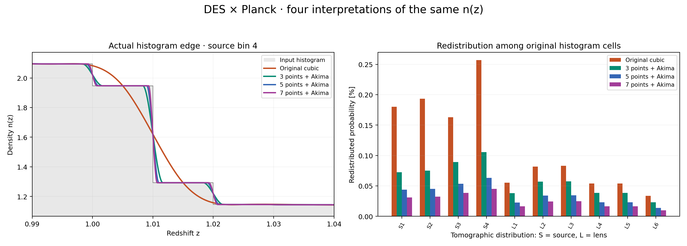

# DES × Planck: optional n(z) reconstruction study

This optional study measures how reconstructing the same input histogram
changes the predicted data vector. Run it separately from routine tests.

## Four reconstructions of the same histogram

`photoz_histogram_akima: 0` is the unchanged default: a curve through the
original bin centres, followed by a natural cubic on a uniform lookup grid.
With `photoz_histogram_akima: 1`, choose `photoz_histogram_akima_factor: 3`,
`5` or `7`. These odd factors retain the centre of each uniform input bin.
Irregular input cells are remapped with overlap-weighted cell averages.
Akima then smooths the transitions between those prepared cells.

The **preparation factor is fixed independently of accuracy**. Raising the
lookup accuracy subdivides the same Akima polynomial algebraically; it does
not refit or sharpen the curve. Both reconstructions use uniform-grid lookup.


This first figure is a **toy histogram**, with coordinates measured in original
bin widths rather than redshift. Its lower row always shows the prescribed
edge at coordinate 3, from 2.45 to 3.55, including both neighbouring cell
centres. Each row uses the same axes across all four columns. This fixed
illustration is separate from the automatic survey close-up explained below.

The preparation points lie at these fractions of each original bin width,
measured from its left edge:

| Preparation factor | Point positions within each bin |
|---|---|
| 3 | 1/6, 1/2, 5/6 |
| 5 | 1/10, 3/10, 1/2, 7/10, 9/10 |
| 7 | 1/14, 3/14, 5/14, 1/2, 9/14, 11/14, 13/14 |

All three factors retain the original bin centre. More points narrow the
smoothed edge; all three Akima curves still redistribute probability between
bins.

The next figure has only two panels: an actual survey histogram edge, and
redistribution of probability among original cells for every source/lens bin.
It samples the compiled C readers at zero photo-z shift, unit stretch and
lookup boost 5; Python does not fit a replacement curve. The shared plotter
is `cosmolike_notebook_utils/plot_nz_reconstruction.py` in CosmoLike core.
The study regenerates this figure automatically after measuring the curves.



**How the panels are constructed.** The left close-up follows the same
rule for every project:

1. Among all source/lens distributions, select the one with the largest
   probability redistribution under the **original cubic**. This selection
   does not depend on which Akima curve differs most.
2. Divide each input cell's normalized probability by its width to obtain
   histogram heights, then find the largest absolute jump between adjacent
   heights. This chooses an interior **bin edge**, not a bin centre.
3. Show two input cells before that edge and three after it, clipping the
   window to the supplied histogram bounds. Exact ties use the first
   distribution or edge in the saved order.
4. Overlay the saved compiled-reader samples for all four reconstructions
   on that same window. No new spline is fitted for display. The vertical
   range includes the histogram and all four curves, including negative
   ringing or boundary cutoffs, with a small margin.

The right panel includes **every** source/lens distribution, independently
of the close-up selection. Its bars show movement of normalized probability
between original cells; total-area changes are reported separately below.

## Model-vector distances

All four arms use the same stored NLA example2 point, histogram files,
mask and supplied covariance. They use `accuracyboost: 5` and
`integration_accuracy: 7`: 8,192 nodes per Limber panel. All quadrature
rules are capped at 8,192, including the source/lens mean-redshift rules.
These are deliberately expensive study settings, not new likelihood defaults.

The distance between two predicted data vectors is

```math
\Delta\chi^2 = (d_b-d_a)^{\mathsf T} C^{-1} (d_b-d_a).
```

Here $`C`$ is the supplied survey covariance. This measures the change in
predictions; it is not the change in goodness of fit to observed data.

| Original → 3 | 3 → 5 | 3 → 7 | 5 → 7 |
|---:|---:|---:|---:|
| 0.1304652 | 0.002228624 | 0.002972851 | 0.0001359452 |

The study adopts practical numerical stability relative to Δχ² = 0.2;
it does not require an exact continuum limit. The earlier boost scan is
preserved in the core study record. Smaller 5→7 distances indicate stability
of this sequence at the tested point, not proof that Akima is physically
more accurate or that every cosmology has converged. Covariance construction
with an Akima kernel requires its own numerical checks.

## Original at defaults versus original refined

This comparison changes only `accuracyboost` and `integration_accuracy`.
The default values are read from the current likelihood YAML; all physical
settings and inputs remain the same stored example2 case.

| Original setting | `accuracyboost` | `integration_accuracy` |
|---|---:|---:|
| YAML defaults | 1 | 0 |
| Refined study | 5 | 7 |

**Original default → refined: Δχ² = 0.022126581.**
This measures numerical accuracy without changing the histogram interpretation.

## Area accounting

At zero photo-z shift and unit stretch, integrate each compiled curve over
every original histogram cell. Split at all polynomial knots: independent
two- and four-point Gauss rules agree to 2×10⁻¹³ absolute per cell.
The table ranges include every source/lens tomographic distribution.

| Reconstruction | Total-area range | Largest redistributed fraction |
|---|---:|---:|
| Original cubic | 0.998939123–0.999981221 | 0.256785% |
| 3-point Akima | 1–1 | 0.105388% |
| 5-point Akima | 1–1 | 0.063233% |
| 7-point Akima | 1–1 | 0.0451665% |

The redistributed fraction, expressed as a percentage, is

```math
R = 50 \sum_i \left| \frac{q_i}{\sum_j q_j} - p_i \right|.
```

- $`p_i`$: normalized input probability in histogram cell $`i`$.
- $`q_i`$: integral of the reconstructed curve over that same cell.

Both sums run over the original histogram cells. The factor 50 converts to
percent and divides by two because moving probability counts as both a loss
and a gain. Normalizing $`q_i`$ separates redistribution from the total-area
change reported in the table; it only affects this diagnostic.

Akima preserves total area for these uniform-bin constructions while moving
probability between cells. This need not hold for irregular bins. Both
reconstructions retain signed input values without clipping or area corrections.

## Run the study

We assume the Cocoa Conda environment is active and the current directory
is `cocoa/Cocoa/`.

**Step :one:**: activate Cocoa.

```bash
source start_cocoa.sh
```

**Step :two:**: run the reconstruction study.

```bash
python -m pytest projects/desy1xplanck/tests/studies/study_nz_reconstruction.py -v -s
```

The study computes all four reconstructions, compares the default and
refined settings, measures cell areas and regenerates the figure. Results
are saved in the temporary directory printed at completion.

To keep the results in a directory of your choice, replace step two with:

```bash
OMP_NUM_THREADS=8 OPENBLAS_NUM_THREADS=1 MKL_NUM_THREADS=1 VECLIB_MAXIMUM_THREADS=1 \
python projects/desy1xplanck/tests/studies/run_nz_reconstruction.py \
  --output /tmp/desy1xplanck-nz-study
```

Use a new output directory to preserve earlier results. To run one stage,
select `--part defaults`, `--part refined` or `--part compare`. The options
`--boost` and `--integration-accuracy` change the numerical accuracy; the
preparation factors remain 3, 5 and 7.

To redraw the committed figure without a cosmology calculation:

```bash
python projects/desy1xplanck/tests/generate_nz_reconstruction_figures.py
```

[Comparison record](results/comparison.json), [default settings](results/defaults.json),
[refined settings and input fingerprints](results/refined.json),
[area audit](results/probability.json), and their adjacent NPZ arrays preserve
the measurements. The inverse covariance is stored once through Git LFS.
